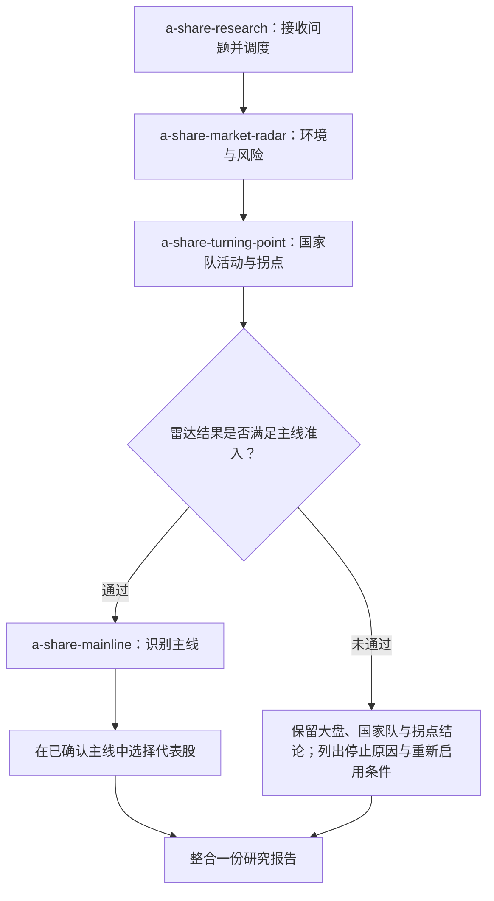

# A股研究 Skills

一组面向A股市场研究的AI技能，覆盖大盘环境、国家队ETF活动、阶段拐点、市场主线和代表股识别，帮助把“看市场、看资金、看方向、看个股”组织成一套有依据、可跟踪的分析流程。

综合研究从 **`a-share-research`** 开始；只关心某一类问题，也可以直接使用对应skill。仓库提供分析指令和方法口径，行情及公告由运行环境中实际可用的数据工具获取。

## 每个skill负责什么

| Skill | 职责 | 主要输出 |
|-------|------|----------|
| [a-share-research](a-share-research/SKILL.md) | 总调度与报告整合，按问题选择分析范围、复用有效结果 | 大盘、国家队与拐点、赛道、个股角色及后续观察的一份综合报告 |
| [a-share-market-radar](a-share-market-radar/SKILL.md) | 判断约20—60交易日的市场环境、量价热度、防御切换和市场结构 | 牛熊或震荡环境及确认状态、风险姿态、主线分析的环境依据；不选赛道或个股 |
| [a-share-turning-point](a-share-turning-point/SKILL.md) | 通过宽基ETF异常成交与净申赎识别国家队活动，跟踪约5—60交易日的阶段反转 | 国家队增减持/调仓迹象及证据层级，顶部、底部各0—100分，以及预警、规则确认和失效条件 |
| [a-share-mainline](a-share-mainline/SKILL.md) | 在环境准入通过后，识别趋势或短线题材主线，并选择已确认主线的代表股 | 主线、候选与退潮方向；龙头、中军、情绪代表股及各自依据 |

龙头强调领涨与带动，中军强调容量与趋势承接，情绪代表股强调接力或高弹性标杆作用。角色允许兼任、争议或空缺，不机械凑齐三只股票。

## 如何协同工作

默认完整研究流程：



协同遵循以下规则：

1. **环境准入由雷达与主线规则决定。** 只有牛市或题材主导的结构性行情已确认，且无防御覆盖、无切换待确认、关键风险已核验时，才展开主线分析。未通过时不列候选方向或股票；通过但暂无确认主线时，可以停在候选观察。
2. **国家队活动与市场反转分别判断。** 可以同时得出“国家队大概率买入、底部尚未确认”。国家队买入、底部高分或规则确认，都不能自动放行主线和选股。
3. **同一问题只补缺少的数据。** 同一交易日、同一时点、口径完整且仍有效的指数数据与雷达结果可以复用；拐点所需历史、ETF份额和净值按需补齐。成交量、成交额和净申赎不能相互替代。
4. **缺项只影响对应结论。** ETF份额缺失时降级国家队活动判断，不自动否定有效的雷达准入；环境准入的关键数据缺失时，停止赛道和个股分析。
5. **各自保留判断依据。** 环境与防御看雷达，国家队与反转看拐点，主线与个股角色看主线skill；出现分歧时说明原因，不强行合成一个方向或总分。

`a-share-research` 最终整合“大盘 → 国家队与拐点 → 赛道 → 个股 → 后续观察”，不会重复粘贴各子skill的完整报告。只问大盘时，完成雷达和国家队与拐点判断后结束。

## 按问题选择入口

| 想解决的问题 | 推荐入口 | 提问示例 |
|--------------|----------|----------|
| 完整研究或更新已有报告 | `a-share-research` | 使用a-share-research分析当前A股，判断国家队动向和拐点，准入通过后再看主线与代表股。 |
| 只看大盘，同时关心国家队和反转 | `a-share-research` | 只看当前大盘：环境如何，国家队是否买入，是否出现顶部或底部确认？ |
| 只判断牛熊、风险与市场结构 | `a-share-market-radar` | 使用a-share-market-radar判断当前环境、防御切换和风险姿态。 |
| 只看国家队ETF活动或阶段拐点 | `a-share-turning-point` | 使用a-share-turning-point判断宽基ETF是否出现国家队增持或退出迹象，并区分事实与推断。 |
| 研究主线及龙头、中军、情绪代表股 | `a-share-mainline` | 使用a-share-mainline先检查环境准入，通过后列出当前主线和代表股，解释依据。 |
| 聚焦指定赛道或股票 | `a-share-research` | 研究某赛道或股票在当前市场中的主线地位与角色，不预设它就是主线或龙头。 |

专项ETF或拐点问题可以直接执行对应分析，不强制展开赛道和个股；指定赛道、股票时，仍须检查大盘准入。

## 数据与使用边界

运行环境需要能够发现并读取相应的`SKILL.md`及其参考文档。本地存在文件不代表技能已被全局注册；具体加载方式取决于所用AI环境，不假定固定安装路径。

数据源按实际能力选择，例如通达信MCP、东方财富MCP、AKShare，或可核验的公开行情和公告。文档列出来源不代表接口、缓存或历史数据已经可用。分析应注明北京时间、行情交易日、盘中/收盘状态、来源、范围与缺项；盘中结论只作临时判断。

- 国家队活动区分已确认与强弱推断；ETF巨量或异常净申购可提供活动迹象，不能把所有异常交易直接写成已确认的主体行为。
- 拐点的0—100分表示固定规则下的证据强度，不是胜率；80分不代表80%的上涨或下跌概率。
- 各skill提供市场研究判断，不提供仓位、具体买卖点或收益承诺。
- 项目维护skill与方法参考。临时研究程序、测试、数据和回测报告放在项目外，不作为项目交付内容。

## 目录

```text
.
├── README.md
├── a-share-research/
│   └── SKILL.md
├── a-share-market-radar/
│   ├── SKILL.md
│   └── reference/radar-reference.md
├── a-share-turning-point/
│   ├── SKILL.md
│   └── reference/turning-point-method.md
└── a-share-mainline/
    ├── SKILL.md
    └── references/mainline-method.md
```

README说明项目分工与入口；具体公式、阈值、确认和失效规则以各skill及其参考文档为准。
